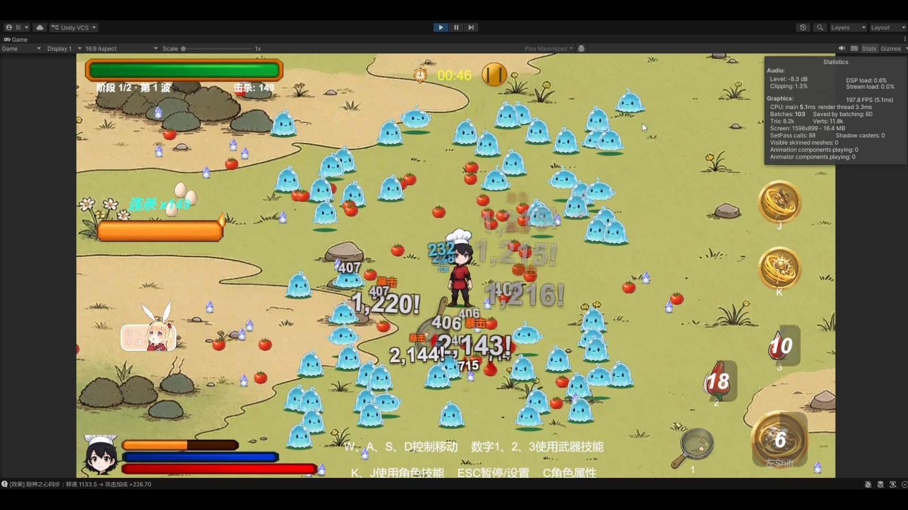
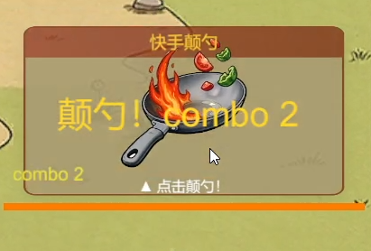
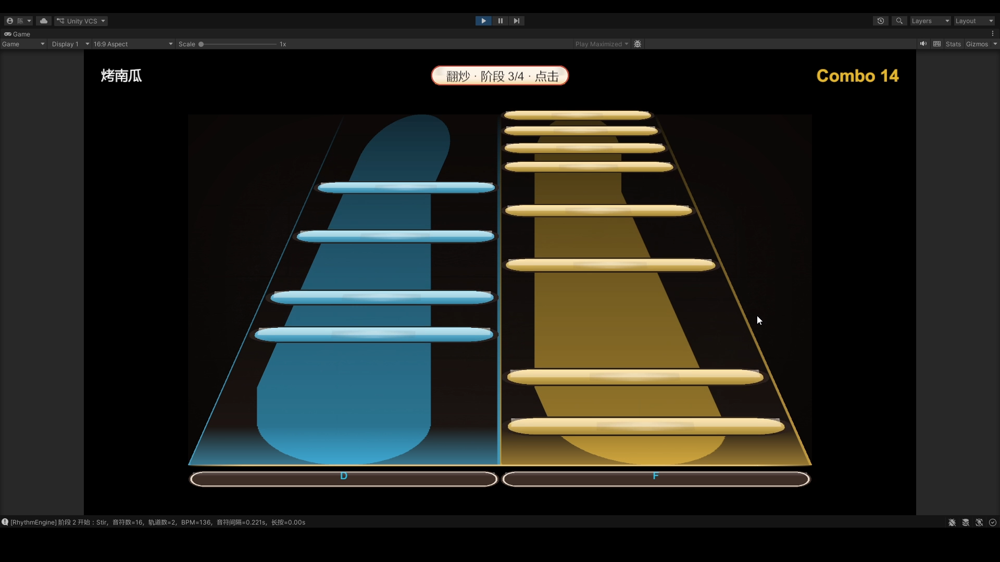

# GrabTheIngredients

|  |  |  |
|:---:|:---:|:---:|
| 波次割草战斗 | 边打怪边炒菜的画中画小游戏 | 音游决胜负的 BOSS 战 |

🎬 **[试玩演示视频（B 站）](https://b23.tv/4fMksO2)**

## 这是什么

**一款你能在 10 秒内看懂的 2D 动作游戏：你扮演一个厨师，被扔进怪物堆里，一边砍怪、一边颠勺炒菜。**

- 打怪掉食材 → 炒菜做成装备"吃"下去变强，**炒菜是不暂停的小游戏**，手忙脚乱才是常态；
- 把 BOSS 血条打空还没完——**最后要过一关音乐节奏挑战**，跟着拍子按，S 评分才能送走 BOSS；
- 打完一局拿奖励，升级菜谱、合成更强的菜、买永久属性，下一局更强。

一句话：**割草游戏的爽 + 炒菜游戏的忙 + 音游的紧张，三件事同时干。**

## 我负责什么

**个人独立开发（作品集项目）**：玩法设计、系统架构、全部 C# 代码（155 个脚本 / 约 3.1 万行）、20 份 JSON 数值配置、数值平衡、性能优化均由本人完成。美术素材为 AI 生成（见[版权说明](docs/TECHNICAL.md#版权说明)）；使用开源基础框架 [YokiFrame](https://github.com/HinataYoki/YokiFrame) 提供事件总线 / UI / 对象池等基础设施，全部玩法系统、存档工程与数值均为独立实现。

## 技术难点与解法

每个难点的完整展开见 [docs/TECHNICAL.md](docs/TECHNICAL.md)，性能优化的实测记录见 [PerformanceNotes.md](PerformanceNotes.md)。

### ① 断点续玩：保存"整个世界"

**难点**：存档瞬间的场面里有上百个活动对象——每只怪的位置血量、每个掉落物、刷怪进度、BOSS 阶段甚至音游判定进度，少存一样续玩就穿帮。
**解法**：全量快照 + 版本迁移链。已实现 **V0→V1.3 共 4 个迁移器**（玩家升级存档不删档）、原子写（临时文件替换防坏档）、**每波开始自动落盘**（强杀进程最多丢 1 波）。

### ② "世界不暂停"的画中画炒菜

**难点**：战斗、炒菜、音游**三套时间轴同时跑**——炒菜面板弹出时怪还在打你，判定窗口、动画、节奏判定互不能抢时间。
**解法**：把"时间语义"从面板里剥离，由独立音游引擎与效果引擎统一驱动（23 个 UI 面板全部只做显示），跨模块通信走 **40+ 强类型事件**，业务与表现零直接引用。

### ③ 割草局的性能：Profiler 定位 + A/B 实测

**难点**：后期波次同屏 **70 个敌人**、一局 **2193 只**怪物与上千掉落物，GC 尖峰和渲染状态切换随混编度暴涨。
**解法**：空间网格把索敌从全图 O(N) 降到局部 O(k)；对象池按同屏上限预热；再用 Profiler 逐帧定位真实热点逐个修（击杀链路落盘合批、命中路径零 GC、HUD 零重建、掉落物图集化）。
**实测数字**（Editor 内 A/B；渲染指标随场上精灵数量波动，故同时给出「平均每批三角面数」——它衡量的是合批率，不受精灵总数干扰）：
**SetPass Calls 297 → 13（↓95%）**、**Batches 329 → 45（↓86%）**、**平均每批三角面 81 → 462（合批率 ×5.7）**、GC 尖峰由密集周期性转为稀疏。
> 判据说明：若仅是精灵变少，Batches 与 Tris 应同比例下降；实测 Tris 仅降 22% 而 Batches 降 86%，说明降幅来自合批本身。

### ④ 数值工程：让 20 分钟的局"一直有事做"

**难点**：单局 **14 波 / 2193 只敌人 / 约 20.5 分钟**的节奏要靠曲线撑住——生成太密杀不过来，太稀就无聊。
**解法**：生成用两段曲线建模，用模拟脚本推演验证，硬约束为**击杀速率 > 生成速率**；伤害公式统一收敛到单一计算器，属性加成收拢到单一聚合器，数值不互相污染。

## 怎么运行

1. 安装 Unity **2022.3.62f3 LTS**，`git clone` 本仓库后用 Unity Hub 打开；
2. 打开 `Assets/Scenes/Boot` 场景；
3. 点 **Play**。

## 架构说明

三层结构：**表现层**（23 个 UI 面板 + 战斗反馈工厂）→ **业务层**（FSM 驱动的 GameManager + 战斗系统群）→ **数据层**（20 份 JSON 配置 + 版本化存档）；所有跨模块通信走事件总线，模块间零直接引用。架构图见 [docs/TECHNICAL.md](docs/TECHNICAL.md#架构总览)。

## 后续计划

- [ ] 敌人贴图资源管线升级（当前为运行时切整图，无法图集化）
- [ ] 遗留性能项：敌人刚体碰撞策略、音游音符对象化
- [ ] 补充后期波次演示 GIF
