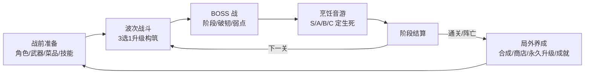
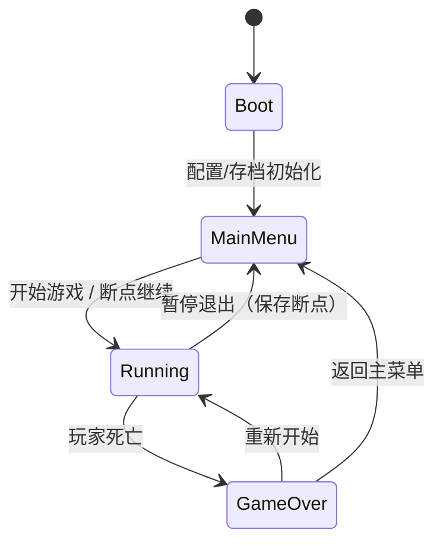
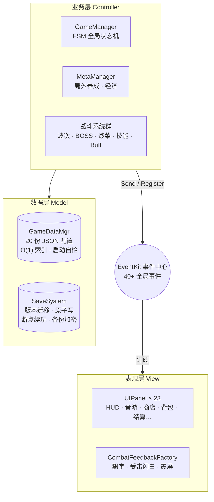

# GrabTheIngredients


> 厨房主题的 Unity 2D Roguelite 动作游戏：**波次割草 × 画中画炒菜 × 烹饪音游 BOSS 战**。
> 全部玩法设计、系统架构与数值平衡由个人独立开发完成。

---

## 核心循环



## 特色玩法

- **画中画炒菜**：战斗进行中弹出的并行小游戏，边打怪边颠勺，命中率映射菜品稀有度与局内增益，炒糊则吃"手忙脚乱"Debuff——世界不暂停，对时间语义的处理与音游互不干扰。
- **烹饪音游 BOSS**：BOSS 血量清空并不意味着胜利，而是切入 4 轨下落式音游；判定品质决定 BOSS 生死，失败即复活重打。
- **战前构筑**：角色差异化属性 + 近战/远程 × 物理/元素武器 + 成品菜装配 + 主动技能组，装配结果实时叠加计算。
- **局外养成**：传说菜永久入包、3 合 1 星级合成、食材出售换钱币、钱币购买永久属性、成就与图鉴系统。

## 技术亮点

### 1. FSM 全局状态机驱动游戏流程

入口管理器 [GameManager.cs](Assets/Scripts/Core/GameManager.cs) 使用有限状态机（`Menu / Running / GameOver`）驱动全局流转：面板只负责显示，管理器只做数据与业务调度，两者仅通过事件与状态机交互。断点续玩、结算发币防重入等边界情况均由状态机收敛。



### 2. 事件中心：模块间零直接引用

[GameEvents.cs](Assets/Scripts/Core/GameEvents.cs) 集中定义 **40+ 全局事件**（struct 强类型），所有跨模块通信走事件总线 `Send / Register`，并统一使用 `UnRegisterWhenGameObjectDestroyed` 防止事件泄漏。业务层广播 `DamageDealt`，表现层工厂（飘字 / 受击闪白 / 震屏）自行订阅播放——业务与表现完全解耦。

### 3. 数据驱动：20 份 JSON 配置

[GameDataMgr.cs](Assets/Scripts/Core/GameDataMgr.cs) 启动时一次性加载全部配置并构建 O(1) 字典索引，附带启动自检。角色、武器、敌人、波次、BOSS、菜谱、音游、效果引擎、经济系统全部配置化——**加新角色、调数值不碰一行代码**。局内 49 张升级 Buff 卡全部由效果引擎按 `trigger` 分流驱动。

### 4. 工程化存档系统

[SaveSystem](Assets/Scripts/SaveSystem/RunSaveManager.cs) 是本项目的工程重点：

- **真·断点续玩**：保存瞬间的完整快照——玩家属性血量、场上每只怪的位置与血量、每个掉落物、刷怪游标、BOSS 破韧与音游进度全部落盘，续玩原样接上；
- **崩溃韧性**：每波开始自动落盘，强杀进程最多丢当前波；
- **版本迁移链**：V0 → V1.3 共 4 个迁移器（[Migrations/](Assets/Scripts/SaveSystem/Migrations/)），存档结构升级不需要玩家删档；
- **可靠性**：原子写（临时文件替换）、坏档自动丢弃、备份与加密。

### 5. 性能优化

- **空间网格** [SpatialGrid.cs](Assets/Scripts/Combat/SpatialGrid.cs)：索敌 / 近战 / AOE 查询从全图 O(N) 降到局部 O(k)，跨格才迁移注册；
- **对象池** [PoolFactory](Assets/Scripts/Pool/PoolFactory.cs) + 预热：同屏上百敌人稳定帧率；
- 查询列表复用、事件驱动 UI（BOSS 血条不再每帧轮询）等细节。

### 6. 数值工程

单局 14 波 / 2193 只敌人生成两段曲线 / 约 20.5 分钟节奏模型，通过模拟脚本推演验证，硬约束为**击杀速率必须大于生成速率**；伤害公式统一收敛到 [DamageCalculator.cs](Assets/Scripts/Combat/DamageCalculator.cs)，属性加成收拢到单一聚合器，避免数值散落各处互相污染。

## 架构总览



## 项目规模

| 指标 | 数量 |
|---|---|
| C# 脚本 | 155 个 / 约 31,000 行 |
| JSON 数据配置 | 20 份 |
| UI 面板 | 23 个 |
| 全局事件 | 40+ |
| 存档版本迁移器 | 4 个 |
| 升级 Buff 卡 | 49 张（全配置驱动） |
| 单局节奏模型 | 14 波 / 约 20.5 分钟 |

## 目录结构

```
Assets/
├─ Resources/
│  ├─ Data/          # 20 份 JSON 数值配置（角色/武器/敌人/波次/BOSS/菜谱/音游/效果引擎/经济…）
│  ├─ Art/           # 2D 美术资源
│  └─ Audio/         # BGM
├─ Scripts/
│  ├─ Core/          # GameManager(FSM)、事件定义、配置/存档/音频/成就等全局系统
│  ├─ Combat/        # 伤害计算、效果引擎、空间网格、状态效果、主动技能
│  ├─ Boss/          # BOSS 控制器 / 阶段 / 破韧 / 音游衔接
│  ├─ Rhythm/        # 烹饪音游引擎
│  ├─ Wave/          # 波次生成
│  ├─ Player/        # 玩家控制 / 属性聚合 / 武器攻击
│  ├─ Enemy/         # 敌人 AI
│  ├─ Drop/          # 掉落系统
│  ├─ Pool/          # 对象池工厂 / 预热
│  ├─ SaveSystem/    # 断点续玩 / 版本迁移 / 备份 / 加密
│  └─ UI/            # 23 个面板（Designer 分部类 + 业务逻辑分离）
Packages/            # 依赖声明（YokiFrame：FSM / EventKit / UIKit / PoolKit）
ProjectSettings/
```

## 运行

1. 安装 Unity **2022.3.62f3 LTS**（Unity Hub）；
2. `git clone` 本仓库后用 Unity Hub 打开项目根目录，等待首次导入；
3. 打开 `Assets/Scenes/Boot` 场景，点击 Play 运行。

## 演示视频与截图

> 🎬 试玩演示视频制作中，完成后在此更新链接。

<!-- 截图准备：将图片放入 Docs/Screenshots/ 目录后取消以下注释


-->

## 技术栈说明

- **引擎**：Unity 2022.3 LTS（UGUI、2D Animation、Tilemap）
- **基础设施框架**：[YokiFrame](https://github.com/HinataYoki/YokiFrame)（开源，提供 FSM / EventKit / UIKit / PoolKit 基础设施）；全部玩法系统、存档工程、数据配置、数值平衡为个人独立实现
- **语言**：C# / JSON 数据驱动 / LitJson

## 版权说明

本项目代码与美术资源仅供学习交流与个人作品展示，未经授权请勿用于商业用途。
